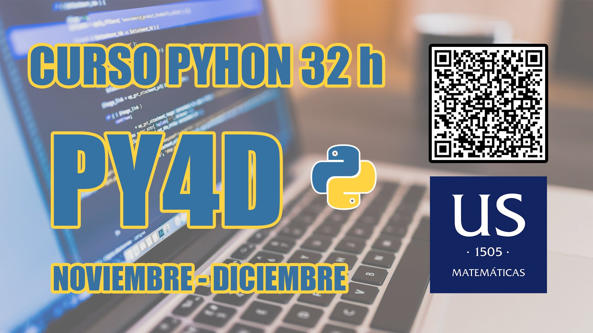

# Curso de Python US



El material de esta página guiará el curso de introducción a Python. A lo largo del mismo veremos los siguientes capítulos 📄

```{tableofcontents}
```

## Cuadernos de trabajo 📘 

El contenido del curso estará estructurado en una serie de cuadernos o notebooks divididos por secciones, que se pueden abrir desde [Google Colab](https://colab.research.google.com/?hl=es), o directamente descargar para trabajar con ellos en local. 

### Ejercicios 
En cada cuaderno encontraremos celdillas de tipo *ejecutable* y de tipo *markdown*. Dentro de estas últimas, algunos bloque de texto estarán contenidos en bloques del tipo *ejercicio*

```
:::{exercise}
:label: my-exercise

# your code for the exercise

:::
```

y también su correspondiente solución

```
:::{solution} my-exercise
:class: dropdown

# your code for the solution

:::

```

que sirven para renderizar los ejercicios y sus soluciones con un formato más visual, todo ello está alojado en [el directorio `notebooks` del repositorio principal](https://github.com/javlintor/curso-python-us/tree/main/notebooks).

## Contribuye 💻

Para contribuir con el curso, ya sea para proponer la solución de algún ejercicio o nuevos ejercicios, corregir erratas, mejorar el contenido del curso, o cualquier cosa que se te ocurra, puedes seguir los siguientes pasos
- crea una **bifurcación** del repositorio en tu cuenta de [github](https://github.com/), pulsando el botón `fork` que aparece arriba a la derecha.
- modifica los notebooks a tu antojo, y crea una [**pull request**](https://docs.github.com/es/pull-requests/collaborating-with-pull-requests/proposing-changes-to-your-work-with-pull-requests/about-pull-requests) contra la rama `main` del repositorio principal 
- tras revisar la propuesta y si los cambios son oportunos, aceptaré la PR y los cambios se desplegarán automáticamente en la página del curso. 

No existe ninguna política para contribuir, pero intenta dar contexto a tu propuesta y que los archivos modificados estén dentro del directorio `notebooks/`. Ten en cuanta que **las etiquetas de los ejercicios son únicas** y que **justo al empezar una solución hay que referenciar el ejercicio correspondiente**. 

Cualquier incidencia o propuesta de mejora, no dudes en escribir en el [apartado de issues](https://github.com/javlintor/curso-python-us/issues) del repositorio.

## Se agradece

Si te gusta el contenido del curso o crees que te ha resultado útil, no olvides premiar con una estrella ⭐️ a este [repositorio](https://github.com/javlintor/curso-python-us). 

## Discord 

También puedes contactarme por correo electrónico <a href = "mailto: jlinarestorres2@gmail.com">En esta dirección</a>

## Referencias 
El material en el que se han basado los capítulos es el siguiente: 
1. [Introducción a Python](introduction-python): 
    - {cite}`beazley2021python`
    - {cite}`Soklaski2021`
    - {cite}`Pythonorg`

2. [Numpy](numpy):
    - {cite}`mckinney2012python`
    - {cite}`harrison2021effective`

4. [Matplotlib](matplotlib):
    - {cite}`mckinney2012python`

3. [Pandas](pandas):
    - {cite}`harrison2021effective`

4. [Casos prácticos](practicas):
    - {cite}`géron2019hands`
    - {cite}`sargent2015quantitative`
